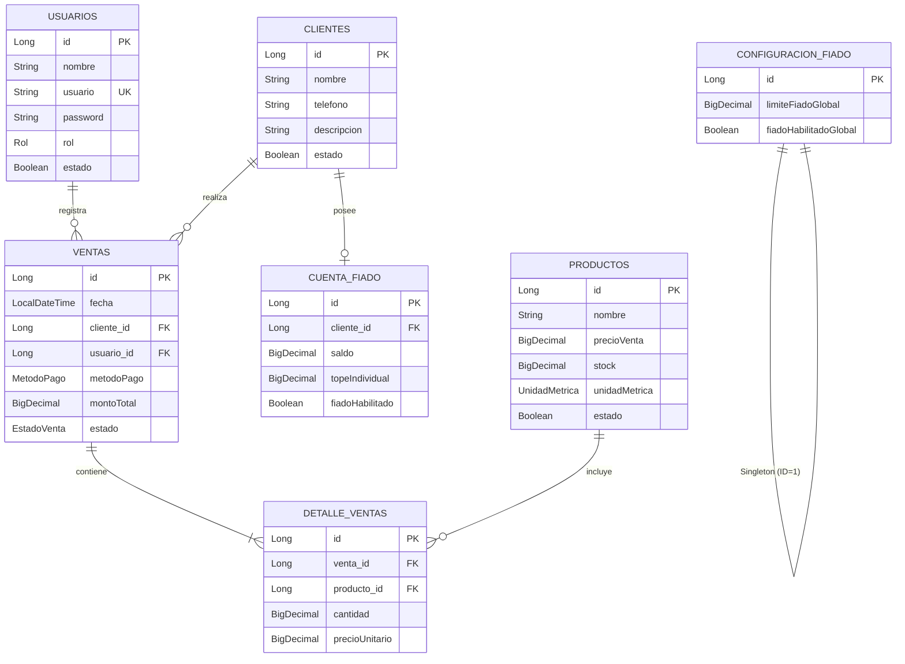

# 🛒 Bodega Application — Backend API

[](https://www.oracle.com/java/)
[](https://spring.io/projects/spring-boot)
[](https://jwt.io/)
[](https://www.mysql.com/)
[](https://gradle.org/)

Sistema de gestión comercial y control de créditos ("fiados") para bodegas y comercios minoristas. Desarrollado con **Java 21** y **Spring Boot 4.1.0**, este backend RESTful automatiza el control de inventarios, gestión de ventas al contado y a crédito, cuentas corrientes de clientes con límites de riesgo configurables y control de acceso basado en roles (RBAC) con tokens JWT.

---

## 📋 Tabla de Contenidos

- [Características Principales](#-características-principales)
- [Arquitectura del Sistema](#-arquitectura-del-sistema)
- [Stack Tecnológico](#-stack-tecnológico)
- [Modelo de Datos](#-modelo-de-datos)
- [Requisitos Previos](#-requisitos-previos)
- [Configuración e Instalación](#-configuración-e-instalación)
- [Endpoints de la API](#-endpoints-de-la-api)
- [Flujos de Negocio Destacados](#-flujos-de-negocio-destacados)
- [Manejo de Excepciones](#-manejo-de-excepciones)
- [Licencia y Créditos](#-licencia-y-créditos)

---

## ✨ Características Principales

- 🔐 **Autenticación y Autorización JWT:** Seguridad *stateless* con soporte de roles (`ADMINISTRADOR`, `VENDEDOR`).
- 💳 **Gestión de Crédito y Fiados:**
  - Control de saldos deudores por cliente.
  - Configuración de límite de crédito **Global** y **Tope Individual** por cliente.
  - Habilitación/Deshabilitación individual o global del servicio de fiado.
  - Registro de abonos/amortizaciones de deuda con validaciones.
- 📦 **Control Atómico de Inventario:** Descuento automático de stock al vender y reposición en caso de anulación de venta.
- 🔄 **Anulación Transaccional de Ventas:** Rollback de saldos de crédito y reposición de inventarios.
- ⚡ **Semilla de Administrador Automática:** `AdminInitializer` genera un usuario administrativo por defecto si la base de datos está vacía.

---

## 🏗 Arquitectura del Sistema

El proyecto sigue una **arquitectura en capas (Controller-Service-Repository)** orientada al dominio:

```text
com.huaman.bodega
├── config/              # Configuraciones de Seguridad, JWT y Beans
├── controller/          # Controladores REST API (@RestController)
├── dto/                 # Data Transfer Objects (Requests y Responses)
├── entity/              # Entidades de Dominio JPA (ORM)
├── exception/           # Excepciones de Dominio y Handler Global
├── repository/          # Interfaces Spring Data JPA Repositories
├── security/            # Filtros JWT y UserDetailsService
├── service/             # Lógica de Negocio e Interfaces
│   └── impl/            # Implementaciones de Servicios (@Service)
└── init/                # Inicilizador de datos (AdminInitializer)
```

---

## 🛠 Stack Tecnológico

| Componente | Tecnología / Librería | Versión |
| :--- | :--- | :--- |
| **Lenguaje** | Java LTS | 21 |
| **Framework** | Spring Boot | 4.1.0 |
| **Seguridad** | Spring Security + Auth0 JWT | `java-jwt:4.6.0` |
| **Persistencia** | Spring Data JPA / Hibernate | 4.1.0 |
| **Base de Datos** | MySQL | Connector 9.x |
| **Herramientas** | Project Lombok, Jakarta Validation | — |
| **Gestor de Builds** | Gradle Wrapper | 9.5.1 |

---

## 🗄 Modelo de Datos



---

## ⚙️ Requisitos Previos

- **Java JDK 21** o superior instalado y configurado en el `PATH`.
- **MySQL 8.0+** en ejecución.
- **Git** y tu IDE de preferencia (IntelliJ IDEA, CLion, Eclipse, VS Code).

---

## 🚀 Configuración e Instalación

### 1. Clonar el Repositorio
```bash
git clone https://github.com/tu-usuario/bodega-backend.git
cd bodega-backend
```

### 2. Configurar la Base de Datos
Crea una base de datos MySQL llamada `bodegadb`:
```sql
CREATE DATABASE bodegadb CHARACTER SET utf8mb4 COLLATE utf8mb4_unicode_ci;
```

### 3. Configurar `application.properties`
Edita la ruta `src/main/resources/application.properties` con tus credenciales de MySQL y la clave secreta para JWT:

```properties
# Server
server.port=8080

# Database
spring.datasource.url=jdbc:mysql://localhost:3306/bodegadb?useSSL=false&serverTimezone=UTC
spring.datasource.username=root
spring.datasource.password=tu_contraseña
spring.datasource.driver-class-name=com.mysql.cj.jdbc.Driver

# JPA / Hibernate
spring.jpa.hibernate.ddl-auto=update
spring.jpa.show-sql=true
spring.jpa.properties.hibernate.format_sql=true

# Security JWT
jwt.secret=TuClaveSecretaSuperSeguraParaJWT2026123456789
jwt.expiration=86400000
```

### 4. Compilar y Ejecutar
```bash
# En Linux/macOS
./gradlew bootRun

# En Windows
gradlew.bat bootRun
```

> **Nota:** Al arrancar por primera vez, `AdminInitializer` creará automáticamente el usuario por defecto:
> - **Usuario:** `admin`
> - **Contraseña:** `admin123`
> - **Rol:** `ADMINISTRADOR`

---

## 📡 Endpoints de la API

### 🔑 Autenticación (`/auth`)
| Método | Endpoint | Descripción | Acceso |
| :--- | :--- | :--- | :--- |
| `POST` | `/auth/login` | Iniciar sesión y obtener token JWT | Público |

### 👥 Clientes y Cuenta Fiado (`/clientes`)
| Método | Endpoint | Descripción | Acceso |
| :--- | :--- | :--- | :--- |
| `POST` | `/clientes` | Registrar nuevo cliente | Autenticado |
| `GET` | `/clientes/listar` | Listar clientes activos | Autenticado |
| `GET` | `/clientes/{id}` | Obtener cliente por ID | Autenticado |
| `GET` | `/clientes/{id}/cuenta-fiado` | Consultar estado de cuenta y deuda | Autenticado |
| `PATCH` | `/clientes/{id}/cuenta-fiado/tope` | Definir tope individual de crédito | `ADMINISTRADOR` |
| `POST` | `/clientes/{id}/cuenta-fiado/abono` | Registrar abono/pago a la deuda | Autenticado |
| `PATCH` | `/clientes/{id}/cuenta-fiado/desactivar` | Deshabilitar opción de fiado para el cliente | `ADMINISTRADOR` |

### ⚙️ Configuración Global de Fiado (`/configuracion/fiado`)
| Método | Endpoint | Descripción | Acceso |
| :--- | :--- | :--- | :--- |
| `GET` | `/configuracion/fiado` | Consultar límite global y estado | Autenticado |
| `PUT` | `/configuracion/fiado` | Modificar límite global y estado del servicio | `ADMINISTRADOR` |

### 🛒 Ventas (`/ventas`)
| Método | Endpoint | Descripción | Acceso |
| :--- | :--- | :--- | :--- |
| `POST` | `/ventas` | Registrar nueva venta (Contado/Fiado/Yape) | Autenticado |
| `GET` | `/ventas` | Listar historial de ventas | Autenticado |
| `GET` | `/ventas/{id}` | Obtener detalle de venta por ID | Autenticado |
| `PATCH` | `/ventas/{id}/anular` | Anular venta, reponer stock y ajustar deuda | Autenticado |

### 📦 Productos e Inventario (`/productos`)
| Método | Endpoint | Descripción | Acceso |
| :--- | :--- | :--- | :--- |
| `POST` | `/productos` | Crear nuevo producto | Autenticado |
| `GET` | `/productos` | Listar catálogo de productos | Autenticado |
| `PUT` | `/productos/{id}` | Actualizar producto | Autenticado |
| `DELETE` | `/productos/{id}` | Eliminar/Desactivar producto | `ADMINISTRADOR` |

---

## 🔄 Flujos de Negocio Destacados

### 1. Procesamiento de Venta a Crédito (Fiado)
```text
[Cliente solicita compra fiada]
              │
              ▼
    ¿Fiado habilitado Globalmente? ──(No)──► [Rechazar Transacción]
              │ (Sí)
              ▼
    ¿Cliente con Fiado Activo?    ──(No)──► [Rechazar Transacción]
              │ (Sí)
              ▼
    ¿Hay Stock Suficiente?         ──(No)──► [Lanzar StockInsuficienteException]
              │ (Sí)
              ▼
  Descontar Stock + Incrementar Deuda
              │
              ▼
    ¿Nueva Deuda > Límite Efectivo? ─(Sí)─► Marcar `excedeLimiteFiado = true`
              │ (No)                          (Generar advertencia en respuesta)
              ▼
      [Confirmar Venta]
```

### 2. Anulación Transaccional de Venta
Al ejecutar `PATCH /ventas/{id}/anular`:
1. Verifica que la venta no haya sido anulada previamente.
2. Restaura automáticamente el stock consumido por cada producto en `DetalleVenta`.
3. Si el método de pago fue `FIADO`, resta el monto total del saldo deudor en `CuentaFiado`.
4. Marca el estado de la venta como `ANULADA`.

---

## ⚠️ Manejo de Excepciones

El sistema cuenta con un controlador global de excepciones (`GlobalExceptionHandler`) que retorna respuestas estandarizadas con código HTTP adecuado:

- `StockInsuficienteException` (`400 Bad Request`)
- `VentaInvalidaException` (`400 Bad Request`)
- `ClienteNoEncontradoException` / `ProductoNoEncontradoException` (`404 Not Found`)
- `ClienteYaExisteException` / `UsuarioYaExisteException` (`409 Conflict`)
- `BadCredentialsException` (`401 Unauthorized`)

---

## ✒️ Autor y Créditos

- **Desarrollador:** Santiago Benjamín Huamán Reyes (`com.huaman.bodega`)
- **Especialidad:** Ingeniería de Software
- **Año:** 2026
